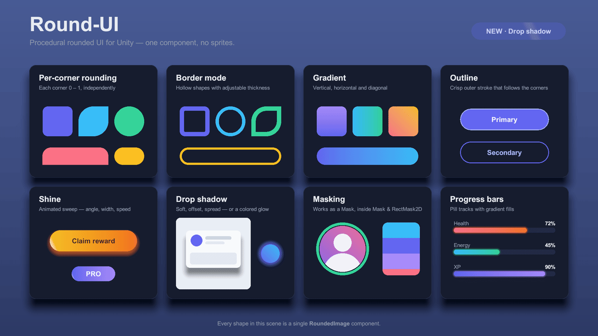

# Round-UI for Unity

**Procedural rounded UI for Unity's Canvas system — one component, no sprites.**

`RoundedImage` is a drop-in replacement for `UnityEngine.UI.Image` that draws rounded rectangles,
pills, circles and rings entirely in a shader. Corners stay pixel-sharp at any size, and gradients,
outlines, an animated shine and soft drop shadows are built in.

The showcase scene (`Assets/Round-UI/Sample.unity`), recorded in Play Mode. Every shape in it is a single `RoundedImage`.

## Features

- **Per-corner rounding**: set each corner independently, from square to fully round.
- **Fill and Border modes**: solid shapes or hollow rings with adjustable thickness.
- **Gradient**: vertical, horizontal or diagonal blend between two colors.
- **Outline**: an outer stroke that follows the rounded corners.
- **Shine**: an animated light sweep with adjustable angle, width, intensity and speed.
- **Drop shadow**: soft shadow with color, offset, blur and spread. It also works as a colored glow.
- **Masking**: works inside `Mask` and `RectMask2D`, and can be used as a `Mask` itself (e.g. circular avatars).
- **Precise hit detection**: clicks outside the rounded shape, or inside a border's hole, are ignored.
- **Plays well with uGUI**: `CanvasGroup` fades, Image color/alpha, sprites, `Filled` type and `Preserve Aspect`.

## Requirements

- Tested with **Unity 6.6** (6000.6) in both the **Built-in Render Pipeline** and **URP**.
- The shader compiles for D3D11, GLES3, Vulkan and Metal (Android / iOS). It has not been tested
  on a physical mobile device or on older Unity versions yet.
- uGUI (`com.unity.ugui`), which is included by default.

## Installation

Copy the `Assets/Round-UI` folder into your project's `Assets` folder, or import the `.unitypackage`
from the repository's Releases page if one is available.

## Quick start

1. **GameObject → UI → RoundUI Image** creates a ready-to-use image. If the scene has no Canvas
   (and no EventSystem), they are created too.
   Or add it to an existing object with **Add Component → UI → RoundUI Image**.
2. Set the corner amounts in the **Corners** section of the Inspector (`0` = square, `1` = fully round).
3. Enable the effects you need: Gradient, Outline, Shine, Drop Shadow.

Open `Assets/Round-UI/Sample.unity` and press Play to see every feature, including the animated shine.

## Inspector reference

### Rounding

| Setting | Description |
|---|---|
| Mode | `Fill` draws a solid shape; `Border` draws a hollow ring. |
| Border Thickness | Ring thickness in `Border` mode (0 – 1). |
| Distance Falloff | Edge anti-aliasing softness. |
| Top Left / Top Right / Bottom Left / Bottom Right | Corner rounding, 0 – 1 (1 = half of the shorter side). |

### HitBox

| Setting | Description |
|---|---|
| Use HitBox Outside | Ignore clicks outside the rounded shape. An enabled outline counts as part of the shape. |
| Use HitBox Inside | In `Border` mode, also ignore clicks inside the ring's hole. |

### Gradient

| Setting | Description |
|---|---|
| Color A / Color B | Gradient colors, multiplied with the Image color. Color A is at the bottom / left. |
| Direction | `Vertical`, `Horizontal` or `Diagonal`. |
| Offset | Shifts the blend point (-1 – 1). |

### Outline

| Setting | Description |
|---|---|
| Color | Outline color. |
| Thickness | Stroke width as a fraction of the shorter side (0 – 0.5). |

### Shine

| Setting | Description |
|---|---|
| Color | Highlight color (its alpha scales the effect). |
| Angle | Sweep direction in degrees. |
| Width / Intensity | Band width and strength. |
| Speed / Loop | Sweeps per second, and whether it repeats. Looping shines with the same settings stay in sync; with Loop off, the shine plays once each time the image is enabled. |

### Drop Shadow

| Setting | Description |
|---|---|
| Color | Shadow color. Use a bright color with zero offset for a glow. |
| Offset | Shadow offset in UI units (negative Y = down). |
| Blur | Edge softness in UI units. |
| Spread | Grows (+) or shrinks (−) the shadow in UI units. |

The shadow follows the rounded corners and border rings, and includes the outline.

## Masking

- **Inside a `Mask` or `RectMask2D`**: rounded images, including their effects, are clipped as usual.
- **As a `Mask`**: add a `Mask` component next to a `RoundedImage` to clip children to the rounded
  shape, e.g. a circular avatar. Only the visible shape masks; its drop shadow is not part of the mask.

## Notes & limitations

- **Batching:** Images with identical effect settings share one pooled material and batch together
  (e.g. a list of cards with the same shadow and outline). Each distinct combination of effect
  settings is its own material. Plain rounded images share the default material. The shine animates
  in the shader, so effects cost nothing per frame on the CPU.
- **Shadow on a Mask:** A `RoundedImage` that is itself a `Mask` doesn't draw its own drop shadow. Put
  the shadow on a separate `RoundedImage` behind it.
- **Image types:** The `Sliced` and `Tiled` Image types are not supported.
- **Filled type:** With the `Filled` type, the fill cuts the rounded shape. For pill-shaped progress
  bars, resize a child image instead (see the sample scene).
- **Shader channels:** The component enables the UV1–UV3 shader channels it needs on its Canvas
  automatically.
- **Clickable outline:** To make the outline clickable, the image grows its `raycastPadding` by the
  outline width in Play Mode. Your own padding value is kept, and the serialized value in the scene
  is never changed.
- **Code access:** Effect settings are serialized Inspector fields; there is no public scripting API
  for them yet.
